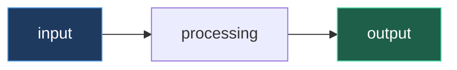

# Note Anatomy — templates for every note type

Full specification of each note type in the vault. Read the section for the note you're about to write.

## Contents

1. [Universal conventions](#1-universal-conventions)
2. [MOC / Start Here](#2-moc--start-here)
3. [How to use this vault](#3-how-to-use-this-vault)
4. [Machine setup](#4-machine-setup)
5. [Study plan](#5-study-plan)
6. [Module overview](#6-module-overview)
7. [Lesson](#7-lesson) ← the important one
8. [Lab](#8-lab)
9. [Concept note](#9-concept-note)
10. [Cross-cutting notes](#10-cross-cutting-notes)
11. [Reference notes](#11-reference-notes)
12. [Study-note template](#12-study-note-template)

---

## 1. Universal conventions

**Frontmatter.** Every note gets tags; module notes get progress fields so a Dataview query can build a progress table.

```yaml
---
tags: [course/<slug>, lesson, module/2]
---
```

Module overviews additionally:
```yaml
---
tags: [course/<slug>, module, module/2]
module: 2
done: false
---
```

**Filenames are the link target.** Obsidian resolves `[[Name]]` by filename anywhere in the vault, so names must be unique and stable. Renaming a note breaks every link to it unless Obsidian does the rename. Use a scheme like `M2.1 - Lesson Title.md` — the prefix guarantees uniqueness and sorts correctly.

**Emoji as navigation, not decoration.** The same emoji always means the same section, so a learner scanning a note finds what they want without reading. 🎯 summary · 🎪 analogy · ⌨️ hands-on · 🏛️ trade-offs · ⚠️ pitfalls · 💥 sabotage · 📚 links · ✅ checklist · 🧪 exercise · 🐞 bug · 🏗️ project.

**Callouts.**

| Syntax | Use for |
|---|---|
| `> [!abstract]` | the one-sentence summary at the top |
| `> [!note]` | theory the learner can skip on first pass |
| `> [!tip]` | a technique that saves time |
| `> [!important]` | something that changes how they think |
| `> [!warning]` | costs them 40 minutes if ignored |
| `> [!danger]` | breaks things / real bug in the source material |
| `> [!question]` | prompt to make them think before reading on |
| `> [!example]` | do this before continuing |
| `> [!quote]` | a line worth remembering |

**Code annotation.** Mark your own comments so the learner can tell them from the original source:

```python
pool_pre_ping=True,   # 👈 sends SELECT 1 before handing out the connection
```

**Table escaping.** A wikilink alias inside a table needs the pipe escaped: `[[Note\|alias]]`. Unescaped, it splits the cell.

**Diagrams.** Mermaid renders natively. Use `flowchart`, `sequenceDiagram`, `timeline`, `gantt`, `xychart-beta`. Style nodes so the diagram reads at a glance:



A palette that works in both Obsidian themes: blue `#1e3a5f/#4a90d9` · green `#2d4a1e/#7cb342` · orange `#5f3a1e/#d9904a` · red `#5f1e1e/#d94a4a` · purple `#4a1e5f/#a04ad9` · teal `#1e5f4a/#4ad9a0`. Always set `color:#fff`.

**Footer.** Every sequential note ends with navigation:
```markdown
**Previous:** [[M2.1 - ...]] · **Next:** [[M2.3 - ...]]
```

---

## 2. MOC / Start Here

The vault's front door. Someone lands here and knows what to do within 30 seconds.

Contains, in order: a one-paragraph "what is this"; a numbered "start here" table (5 rows max) pointing at setup → plan → first lesson; a mermaid diagram of all modules with dependency arrows; the module index as links; the canvas links; cross-cutting notes; concept notes as a compact grid; a "what you'll be able to do" list of 6-8 concrete capabilities; and a Dataview progress block with a fallback note for people who don't have the plugin.

The capability list is the most important part — it's what makes someone decide to start. Write outcomes, not topics: "Explain why hybrid search beats pure vector search, with numbers" not "Learn about hybrid search."

---

## 3. How to use this vault

Explains the method, not the content. Cover:

- **The inversion.** Why this vault exists: reading code teaches recognition, writing it teaches understanding. A small mermaid loop: concept → you write it → compare → break it → consolidate.
- **Anatomy of a lesson.** A table mapping each emoji section to what it is, so navigation becomes automatic.
- **Conventions.** Callout meanings, the `# 👈` marker, link types.
- **The 4-step study method.** Cold read (no keyboard) → build → diff against the source → lab and sabotage. Give the actual diff command.
- **Two repositories.** The source is the answer key; they build their own. Show the directory layout. If the vault lives in a synced folder (Drive, Dropbox, iCloud), warn that the *code* must not — `.venv`, node_modules and container volumes will fight the sync client.
- **Plugins worth installing.** Dataview (progress tables), Excalidraw (redrawing diagrams by hand beats reading them), Advanced Tables. Note that Mermaid needs nothing.
- **Pace options.** A table of hours/week → total duration, so they can choose honestly.
- **When stuck.** An ordered checklist ending with "read the Known Bugs note — it might not be you."

---

## 4. Machine setup

Everything needed before lesson one, on the learner's actual OS (check the environment; don't write macOS instructions for a Windows user).

Requirements table with minimum *and* comfortable specs, plus a column explaining *why* each requirement exists — "OpenSearch reserves 512 MB of heap, Postgres runs twice, and Ollama loads a model" makes the number meaningful.

Then numbered install steps with a verification command after each one, free API keys with links, and a smoke test that proves the machine can carry the course. End with a pitfalls table (symptom → cause → fix) and a checklist.

Never write an install step without the command that proves it worked.

---

## 5. Study plan

Opens by justifying the timeline. If the source claims N weeks and that's the time to *run* the code, say so and show the arithmetic for learning it: read + rebuild + lab, times the module count, divided by realistic hours per week.

Then: a week-by-week table (week / focus / notes to read / deliverable), alternative tracks for different goals ("I only want the agent part", "I'm a data person"), a typical week's day-by-day breakdown, a module checklist, and an honest pass criterion.

The pass criterion should be three things they can do *without consulting*: draw the module's diagram, explain each new dependency and why, and name where it would fail in production.

---

## 6. Module overview

~120 lines. The learner reads this without a keyboard.

```markdown
# M<N> · <Capability gained>

> [!abstract] 🎯 In one sentence
> What this module makes possible, and why it comes here in the sequence.

**Duration:** N weeks (~X h) · **Prerequisite:** [[previous lab]]
**Corresponds to:** <source material section, if any>

## 🎪 The analogy
The whole module in one image, usually a table mapping the analogy's parts
to the system's parts.

## 🗺️ What you'll build
A mermaid diagram of the module's slice of the system.

## 📖 Lessons
| # | Lesson | Time | What you master |

## 🧠 Concepts that appear here
Links to the atomic notes.

## 🏛️ The architectural decisions of this module
2-4 decisions, each as: the decision, the alternative rejected, why, and the cost.

## ⚠️ Classic mistakes
Numbered, with the reason each one happens.

## ✅ You're done with M<N> when
- [ ] Verifiable criteria
```

If the module's source material has bugs, add a `> [!danger]` block warning the learner before they start, linking to the bugs note.

---

## 7. Lesson

The core unit. 200-450 lines. This is where the course lives or dies.

### Header

```markdown
# M2.1 · <Title>

> [!abstract] 🎯 In one sentence
> The version you'd say to a colleague in an elevator.

⏱️ ~3 h · 📄 Reference: `src/services/arxiv/client.py` · 🧠 [[Concept note]]
```

The file reference must be a real path in the source material. The learner will open it.

### 🎪 The analogy

One concrete everyday situation. Not "imagine a system that..." — an actual thing they've experienced. Calling a government office. A restaurant kitchen. A furnished apartment. Then map it explicitly, usually with a table or by naming the parts as you introduce the code.

Test for a good analogy: it should predict a behaviour the learner hasn't seen yet. "Containers talk through the building intercom, not the street" predicts why `localhost` fails between containers — before they read a line of Docker.

### ⌨️ Hands-on

Numbered steps, each with a heading. Real code from the source, or code the learner types to build toward it. Comment the lines that carry a decision:

```python
pool_pre_ping=True,        # 👈 tests the connection before handing it out
expire_on_commit=False,    # 👈 without this, reading .title after commit re-queries
```

Interleave short callouts explaining anything surprising. When a step's *why* takes more than three lines, pull it into a `> [!note]`.

Include the commands to verify each step actually worked.

### 🏛️ Why this way?

The section that separates this from a tutorial.

```markdown
| Decision | Alternative | Trade-off |
|---|---|---|
| `httpx` | `requests` | native async, HTTP/2; less ubiquitous, fewer SO answers |
| Manual rate limiter | `tenacity` | zero deps, you understand every line; not distributed |
```

Then, when a decision is genuinely arguable, a `> [!question]` that raises it and asks the learner to form an opinion. Not rhetorical — actually contestable. Suggest they write down where they disagree.

### ⚠️ Pitfalls

Where people get stuck, as a symptom → cause → diagnosis table, plus the diagnostic commands they'll use for the rest of their career:

```bash
docker compose logs -f api       # 70% of problems are visible here
docker compose config            # shows the YAML with variables resolved
```

### 💥 Break it on purpose

4-6 numbered sabotages. Each names the change, what to observe, and leaves the observation to the learner.

```markdown
1. **Remove the healthcheck** from postgres and the `condition: service_healthy`
   from the api. Bring it up from scratch. Symptom: ______
2. **Set `temperature=1.5`** and run the same prompt three times. Compare.
```

Order them from cheap to expensive. Mark anything that could cause real damage (rate-limit bans, cost) with a warning and a safe variant.

The experiment that teaches the most goes last and gets called out: *"this experiment is worth more than three articles on asyncio."*

### 📚 Go deeper

Split by depth so the learner can choose:

```markdown
**Essential**
- 🌐 [Title](url) — one line on what it gives you
- 📄 [Paper](url) — 2 pages, the source of the technique

**Advanced**
- 📖 [Book](url) — the definitive treatment, chapters 6 and 11
- 🎥 [Talk](url) — the best visual explanation that exists
```

Icons: 🌐 docs/article · 📄 paper · 📖 book · 🎥 video. 3-4 essential, 3-5 advanced. Every link needs a reason; a bare URL list is noise. Prefer primary sources (official docs, original papers) over aggregator blog posts.

### ✅ Checklist

Verifiable, not aspirational. "You measured the difference in response size with and without `excludes`" beats "You understand `_source` filtering."

---

## 8. Lab

One per module, ~250 lines. Where the learner proves it.

**Exercises** — 5-8, each with a difficulty star rating and a clear deliverable:

```markdown
## 🧪 Exercise 3 — <Name> (⭐⭐⭐ hard)

<What to build, with a code skeleton if it saves pointless typing.>

**Prove it works:** <the observable that shows success>
**Then answer in writing:** <a question that forces reflection>
```

Difficulty: ⭐ mechanical · ⭐⭐ requires understanding · ⭐⭐⭐ requires design judgment. Mark the highest-value exercise with 🏆 and the ones that fix real bugs with 🔥.

Prefer exercises that produce something measurable. "Implement reranking and report the change in MRR on your golden set" beats "add reranking."

**Mandatory sabotages** — a checklist consolidating the lesson sabotages, with blanks:

```markdown
- [ ] **S1** — Two semaphores at (5,5) vs (5,1): peak RAM ______ / ______
- [ ] **S2** — Nested semaphores: total time before ______ after ______
```

**Mini-project** — integrates the whole module into one deliverable. In the last module this becomes the capstone: their own domain, their own data, with a requirements list and an excellence list.

**Self-assessment** — 10 questions answerable without consulting. These double as an interview-prep artifact, so write them the way an interviewer would ask.

**Reflection** — 3-4 open prompts pointing at the study-note template. Always include "what do you still not understand?" — naming the gap is what closes it.

---

## 9. Concept note

60-140 lines. One idea, explained once, linked from everywhere.

```markdown
# <Concept>

> [!abstract] In one sentence
> The definition someone could repeat after reading it once.

Full lesson: [[M4.2 - ...]]

## The intuition
Analogy or diagram. Shorter than the lesson's version.

## <The mechanism>
Formula, algorithm, or diagram. If there's math, show a worked example with
real numbers — the number is what makes it stick.

## Where it wins and where it fails
A table of cases with a verdict per case. This is usually the most-reread
part of the note.

## Practical notes
Bullets a practitioner needs: defaults worth knowing, when to tune, the
mistake everyone makes once.

## 📚 Go deeper
3-5 links.

**Related:** [[other concepts]]
```

Write a concept note when you catch yourself explaining the same thing in two lessons — that's the signal, and it usually happens while writing lesson four.

---

## 10. Cross-cutting notes

Live in `08 - Cross-cutting/`, referenced from multiple modules.

**Architecture — principles and patterns.** Layer diagram, the rules ("a router never builds SQL"), where the source material *breaks its own rules* and what that teaches, the patterns present with a one-line "what it solves", SOLID assessed honestly against the real code, a trade-off table of the structural decisions, and a reusable checklist for judging any codebase.

**Known bugs.** Only when the source is a codebase. See `source-audit.md` for the full spec. Structure: blocking / serious / minor, each with symptom, cause, fix, severity, and a link to the lesson that teaches it. Ends with a fix-order diagram and — this is the part that matters — the *principles* behind the bugs. "A silent fallback turns a fatal bug into plausible wrong behaviour" is worth more than any single fix.

**Testing strategy.** The pyramid adapted to the domain, what already exists in the source, configuration, one worked example per level, and the special problem of testing non-deterministic systems if the subject involves LLMs or randomness.

**Evaluation.** How to know the thing is good. Metrics with runnable implementations, how to build a golden set, how to use a model as judge (and its biases), and regression tests with thresholds in CI. For most technical subjects this is the note that separates a portfolio project from a system.

**Going to production.** What changes when it stops being a laptop: security (with a table of what's currently open), scale (what breaks first, at what volume), cost (do the arithmetic with real numbers), data (backup, migration, retention, privacy), operations (what to monitor and alert on), deploy options by cost and complexity, and a bloqueante/important/desirable checklist.

---

## 11. Reference notes

**Tool index.** Every library and service, grouped by role. Per entry: what it does, why it was chosen here, alternatives, the doc link, and the lesson that uses it. Flag anything in the dependency list that is declared but never imported — that's usually a bug or an abandoned intention, and it's a good exercise.

**Curated external links.** Grouped by kind (books, papers, articles, videos, tools, feeds) with a difficulty marker 🟢🟡🔴 and one line each. Mark the 3-5 items that are genuinely essential with 🏆. Prefer free and primary sources. A learner who reads only the 🏆 items should still be ahead.

**Glossary.** Every technical term in the course, one line each, alphabetical, linking to the full note where one exists. Include terms from the source material's own docs even when the course doesn't dwell on them — the learner will meet them.

---

## 12. Study-note template

Goes in `99 - Templates/`. The learner copies it after each module. Keep it short enough that they'll actually fill it in.

Sections: one-sentence summary in their own words · the 3 things not to forget · what surprised them · **what they still don't understand** (as an unchecked checklist — it becomes their revision list) · one architectural decision they disagree with and what they'd do instead · a table of what they broke and what they learned · links to related notes · a code snippet worth keeping and why · next action.

The "disagree with" section is doing real work: being able to argue with a design is the strongest signal that someone understood it.
